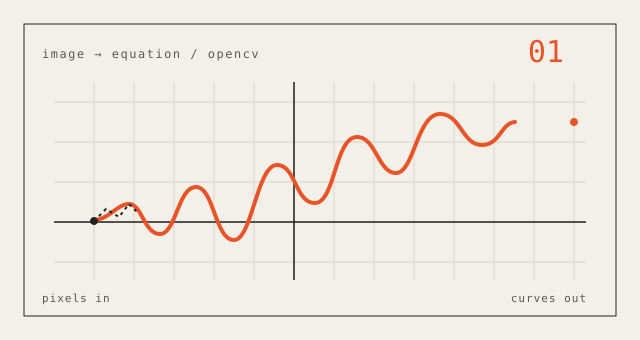
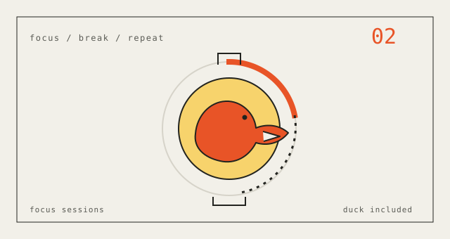
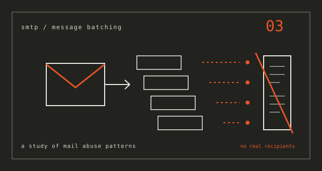

  

field notes &nbsp; / &nbsp; 00

# gedeon koh

i’m a young engineer, researcher and builder. electronics, software, machine learning and 3d modelling all end up on the same workbench; i like testing where they meet, and thinking about who the result is for.

---

## selected work

index &nbsp; / &nbsp; jump to a project

[01 &nbsp; desmosify](#desmosify) &nbsp; / &nbsp; [02 &nbsp; dondondducky](#dondondducky) &nbsp; / &nbsp; [03 &nbsp; spamurai](#spamurai)

 

01 &nbsp; / &nbsp; image → equation

<h3 id="desmosify"><a href="https://github.com/gedeonkoh/Desmos-Image-Graphing-Calculator">desmosify ↗</a></h3>

image contours, translated into equations you can explore in desmos.

python &nbsp; · &nbsp; opencv &nbsp; · &nbsp; desmos

 

---

02 &nbsp; / &nbsp; focus, with a duck

<h3 id="dondondducky"><a href="https://github.com/gedeonkoh/DonDonDucky">dondondducky ↗</a></h3>

a study companion for focus sessions, tasks, calendars and the small satisfaction of keeping a streak alive.

swiftui &nbsp; · &nbsp; live activities

 

---

03 &nbsp; / &nbsp; smtp, examined

<h3 id="spamurai"><a href="https://github.com/gedeonkoh/Spamurai.py">spamurai.py ↗</a></h3>

an adversarial mail experiment: bulk batching, payload chunking and forged warning templates. a study of how ordinary email tools can be misused.

python &nbsp; · &nbsp; smtp

 

  
<code>open the margin notes</code> &nbsp; / &nbsp; see what’s inside

   

  - **desmosify** — the repository contains jupyter notebooks; its image workflow uses opencv contours and generates desmos-ready equations.
  - **dondondducky** — a swiftui app with a focus timer, calendar, to-do lists, history, streak tracking and a lock-screen live activity.
  - **spamurai.py** — python scripts for timed smtp message batches and phishing-style templates. the repository describes misuse risks; keep any testing confined to accounts and systems you control.

---

<a href="https://www.linkedin.com/in/gedeonkoh">linkedin</a> &nbsp; / &nbsp; <a href="https://beacons.ai/gedeonkoh">portfolio</a>

